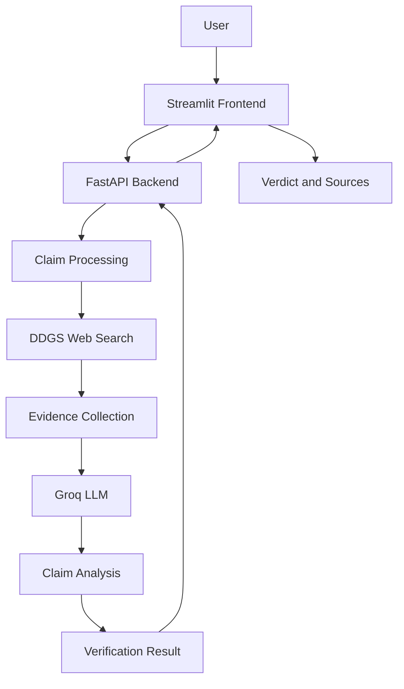

# 🔍 ClaimVerify — AI-Powered Claim Verification System

**ClaimVerify** is an AI-powered fact-checking application that analyzes user-submitted claims, searches the web for relevant evidence, and uses Large Language Models (LLMs) to generate evidence-based verification results.

The project aims to help users evaluate the credibility of online information through automated evidence retrieval and AI-assisted analysis.

<p align="center">
  <strong>Verify Claims. Explore Evidence. Think Critically.</strong>
</p>

---

## 🌐 Live Demo

* **Frontend:** [Live Application](YOUR_FRONTEND_RENDER_URL)
* **Backend:** [Backend API](YOUR_BACKEND_RENDER_URL)
* **API Documentation:** [Swagger UI](YOUR_BACKEND_RENDER_URL/docs)

---

## ✨ Key Features

* **AI-Powered Verification:** Analyzes submitted claims using an LLM.
* **Live Web Search:** Retrieves relevant information from the internet using DDGS.
* **Evidence-Based Analysis:** Evaluates claims using retrieved search results.
* **Clear Verdicts:** Generates understandable outcomes such as Likely True and Likely False.
* **Source References:** Displays relevant sources for independent verification.
* **REST API:** FastAPI-powered backend for claim verification.
* **Interactive Interface:** User-friendly Streamlit frontend.
* **Cloud Deployment:** Independently deployed frontend and backend on Render.

---

## 🛠️ Tech Stack

| Component              | Technology    |
| ---------------------- | ------------- |
| Programming Language   | Python        |
| Frontend               | Streamlit     |
| Backend                | FastAPI       |
| AI / LLM               | Groq API      |
| LLM Model              | GPT-OSS 120B  |
| Web Search             | DDGS          |
| API Server             | Uvicorn       |
| Environment Management | Python dotenv |
| Deployment             | Render        |
| Version Control        | Git & GitHub  |

---

## 🏗️ System Architecture



### How It Works

1. The user submits a factual claim through the Streamlit interface.
2. The frontend sends the claim to the FastAPI backend.
3. The backend processes the claim and searches for relevant web information.
4. Relevant search results are collected as evidence.
5. The evidence is passed to the Groq-powered LLM for analysis.
6. The backend generates a verification verdict.
7. The frontend displays the verdict and supporting sources.

---

## 📂 Project Structure

```text
ClaimVerify/
│
├── backend/
│   ├── main.py
│   └── services.py
│
├── frontend/
│   └── app.py
│
├── .env.example
├── .gitignore
├── .python-version
├── requirements.txt
└── README.md
```

---

## ⚙️ Installation & Setup

### Prerequisites

* Python 3.12+
* Git
* Groq API Key

### 1. Clone the Repository

```bash
git clone https://github.com/Gaurav1st/ClaimVerify.git
cd ClaimVerify
```

### 2. Create a Virtual Environment

```bash
python -m venv .venv
```

### 3. Activate the Virtual Environment

**Windows (Git Bash):**

```bash
source .venv/Scripts/activate
```

**Linux / macOS:**

```bash
source .venv/bin/activate
```

### 4. Install Dependencies

```bash
pip install -r requirements.txt
```

### 5. Configure Environment Variables

Create a `.env` file in the root directory.

```env
GROQ_API_KEY=your_groq_api_key_here
GROQ_MODEL=openai/gpt-oss-120b
```

Replace the placeholder with your own Groq API key.

**Important:** Never upload your `.env` file or expose your API key publicly.

### 6. Start the Backend

```bash
uvicorn backend.main:app --reload --port 8000
```

Backend:

```text
http://localhost:8000
```

API Documentation:

```text
http://localhost:8000/docs
```

### 7. Start the Frontend

Open another terminal:

```bash
streamlit run frontend/app.py
```

Frontend:

```text
http://localhost:8501
```

---

## 🔗 API Endpoints

| Method | Endpoint  | Description                     |
| ------ | --------- | ------------------------------- |
| GET    | `/health` | Check backend health            |
| POST   | `/verify` | Submit a claim for verification |
| GET    | `/docs`   | Interactive API documentation   |

For detailed request and response information, refer to the FastAPI Swagger documentation.

---

## 🚀 Deployment

ClaimVerify is deployed on **Render** using two independent services.

| Service  | Technology |
| -------- | ---------- |
| Backend  | FastAPI    |
| Frontend | Streamlit  |

### Backend Configuration

**Build Command:**

```bash
pip install -r requirements.txt
```

**Start Command:**

```bash
uvicorn backend.main:app --host 0.0.0.0 --port $PORT
```

Environment Variables:

```env
GROQ_API_KEY=your_groq_api_key
GROQ_MODEL=openai/gpt-oss-120b
```

### Frontend Configuration

**Build Command:**

```bash
pip install -r requirements.txt
```

**Start Command:**

```bash
streamlit run frontend/app.py --server.address 0.0.0.0 --server.port $PORT
```

Environment Variable:

```env
API_URL=your_backend_render_url
```

---

## 🔮 Future Enhancements

* Source credibility scoring.
* Multi-language claim verification.
* Improved evidence ranking.
* Historical claim verification.
* Advanced confidence assessment.
* Detailed claim verification reports.
* Enhanced evidence analysis.

---

## ⚠️ Disclaimer

ClaimVerify provides AI-assisted fact-checking and does not guarantee absolute accuracy.

* AI-generated verdicts may contain errors.
* Search results may be incomplete or outdated.
* Sources should be reviewed independently.
* Important claims should be verified using reliable primary sources.

The generated verdict should be treated as an informed assessment, not absolute proof.

---

## 👥 Team

This project was developed collaboratively by:

* **Brijesh Kumar Trigun**
* **Anmol Sherawat**
* **Anurag Mishra**
* **Gaurav Dwivedi**

<p align="center">
  <strong>Built with ❤️ by Team ClaimVerify</strong>
</p>


**Project:** ClaimVerify — AI-Powered Claim Verification System

---

<p align="center">
  Built with ❤️ by Team ClaimVerify
</p>
